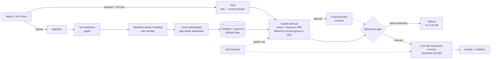

# DocPilot

**Ask questions about your organisation's documents and get answers that cite their sources, and refuse when the answer isn't there.**

DocPilot is a general-purpose retrieval-augmented generation (RAG) service for any company's documents: HR policies, handbooks, product docs, runbooks, contracts. Upload PDFs, Markdown or text files and ask questions in plain language. It is built with FastAPI, PostgreSQL + pgvector and any OpenAI-compatible LLM, and ships with an evaluation harness so retrieval and answer quality are measured, not guessed.


## Architecture



## Features

- **Ingestion:** PDF, TXT and Markdown; duplicate uploads detected by SHA-256.
- **Chunking:** sentence-aware packing with overlap; chunks never cross pages, so every citation points to one page.
- **Embeddings:** local `BAAI/bge-small-en-v1.5` via fastembed: free, CPU-only, no PyTorch.
- **Hybrid search:** pgvector cosine search (HNSW index) plus Postgres full-text search (`tsvector`, GIN index, `ts_rank_cd`), merged with Reciprocal Rank Fusion. Keyword search catches exact terms embeddings blur, such as policy codes, product names and numbers. `RETRIEVAL_MODE=hybrid|vector` (hybrid by default), or per request.
- **Reranker (optional):** a local cross-encoder (`ms-marco-MiniLM-L-6-v2`) re-orders the top 20 candidates. `RERANK=true|false`, or per request.
- **Grounded answers:** numbered sources in the prompt, mandatory `[n]` citations, exact refusal sentence when the answer isn't in the sources.
- **Relevance gate:** if the best chunk scores below `MIN_RELEVANCE`, DocPilot refuses without calling the LLM. This cuts cost and removes a whole class of hallucinations.
- **Access control (RBAC):** every document belongs to an access group (`all`, `hr`, `finance`, `engineering`); every API key maps to the groups it may read. Retrieval filters by group inside SQL, so restricted chunks never reach the reranker or the LLM. See [Security](#security).
- **Prompt-injection guard:** retrieved text is labelled untrusted data in the system prompt, and a dedicated injection test set measures whether answers obey planted instructions.
- **Streaming:** Server-Sent Events (`sources` → `token`… → `done` / `error`).
- **Observability:** per-request timings for retrieval and generation.
- **Provider-agnostic:** Gemini, OpenAI, Groq or a local Ollama model, switched by configuration only.
- **Evaluation harness:** retrieval hit@1, hit@k and MRR, answer accuracy, refusal accuracy, false-refusal rate, citation rate and latency p50/p95.
- **Tests and CI:** unit and API tests run without a database or API key; integration tests prove access control against real Postgres; a retrieval eval gate fails the build if quality drops. See [CI](#ci).

## Quickstart

Requirements: Python 3.11+, and Postgres with pgvector, from either Docker or Homebrew.

**1a. Postgres with Docker**

```bash
docker compose up -d
```

**1b. Postgres with Homebrew (macOS, no Docker)**

```bash
brew install postgresql@17 pgvector
brew services start postgresql@17
export PATH="$(brew --prefix postgresql@17)/bin:$PATH"

psql postgres -c "CREATE ROLE docpilot LOGIN PASSWORD 'docpilot'"
createdb -O docpilot docpilot
psql docpilot -c "CREATE EXTENSION vector"   # needs your admin user; the app's role doesn't need superuser
```

Both options match the default `DATABASE_URL` in `.env.example`.

**2. Install, configure and run**

```bash
cd backend
python -m venv .venv && source .venv/bin/activate   # Windows: .venv\Scripts\activate
pip install -r requirements-dev.txt
cp .env.example .env        # then add LLM_API_KEY (free Groq or Gemini keys work)
uvicorn app.main:app --reload
```

Open http://localhost:8000 for the UI, or http://localhost:8000/docs for the interactive API docs. Every endpoint except `/health` needs an API key: paste a demo key (below) into the UI, or click **Authorize** in `/docs`.
The first upload downloads the embedding model (~130 MB) once; the first reranked query downloads the reranker (~80 MB).

## API

| Method | Path | Purpose |
|---|---|---|
| `POST` | `/documents` | Upload and index a file (multipart `file`, optional `access_group`, default `all`) |
| `GET` | `/documents` | List the documents this key can see |
| `DELETE` | `/documents/{id}` | Remove a document and its chunks (only within the key's groups) |
| `POST` | `/search` | Retrieval only: `{"query", "top_k", "mode", "rerank"}` |
| `POST` | `/ask` | Answer with sources and timings: `{"question", "top_k", "mode", "rerank"}` |
| `POST` | `/ask/stream` | Same, streamed as Server-Sent Events |
| `GET` | `/health` | Database and LLM configuration status |

All endpoints except `/health` require an `X-API-Key` header and return `401` without a valid one. `mode` (`"vector"` or `"hybrid"`) and `rerank` (`true` / `false`) are optional and default to `RETRIEVAL_MODE` and `RERANK`.

```bash
curl -s localhost:8000/ask -H 'X-API-Key: dp_demo_hr' -H 'Content-Type: application/json' \
  -d '{"question": "How many days of paid leave do employees get?", "mode": "hybrid"}'
```

## Security

### API keys and access groups

- **Access groups.** Each document is uploaded into one group: `all` (everyone), `hr`, `finance` or `engineering`. Each API key lists the groups it may read and write; every key can also read `all`.
- **Keys are hashed.** The `api_keys` table stores only the SHA-256 of each key, never the key itself. Create a key with `python -m app.auth create-key finance-bot --groups finance` (run from `backend/`); it is printed once.
- **Demo keys.** On startup DocPilot seeds four well-known keys for local use: `dp_demo_admin` (all groups), `dp_demo_hr`, `dp_demo_finance` and `dp_demo_engineering`. Set `SEED_DEMO_KEYS=false` anywhere real.
- **Filtering happens in SQL, before ranking.** Both retrievers have `WHERE d.access_group = ANY(:groups)`, so restricted chunks are never scored, fused, reranked, returned by `/search` or put in an LLM prompt by `/ask` and `/ask/stream`. Filtering after retrieval would also hurt quality, because restricted chunks would use up the top-k slots.
- **Filtered vector search still returns k results.** HNSW indexes apply `WHERE` clauses after the index scan, so a restrictive filter can silently return fewer than k chunks. Each connection sets `hnsw.iterative_scan = strict_order` (pgvector 0.8+) so the scan continues until enough rows pass the filter.
- **No information leaks through side doors.** Listing and deleting are scoped to the key's groups. Deleting a document you can't see returns `404`, not `403`. Re-uploading a restricted file returns `409` without its name.

**Tested end to end.** [`test_rbac_integration.py`](backend/tests/test_rbac_integration.py) runs against real Postgres and real embeddings. It indexes an HR-only document containing a unique canary string, then shows that an engineering key cannot reach it through `/search` (vector and hybrid), `/ask`, `/ask/stream`, listing, deleting or re-uploading. A stubbed LLM records every prompt, so the test checks that the canary never appears in what would be sent to the model. Removing the SQL filter makes four of these tests fail.

### Prompt injection

Uploaded documents are untrusted: anyone who can upload can plant instructions aimed at the model. Defences:

- The system prompt marks sources as untrusted data and tells the model to ignore instructions inside them.
- Sources are numbered and quoted as data in the user turn, separate from the system instructions.
- Measured, not assumed: `evals/injection_docs/` holds three documents with planted attacks (instruction override, a phishing link, a system-prompt leak request, a hidden HTML-comment ad, a false-figure instruction and a role-play switch), and `evals/injection.jsonl` asks ordinary questions whose retrieved chunks contain those attacks. A case fails if the answer contains any of the attack's `forbidden` markers.

Result on 13 Oct 2026 with `openai/gpt-oss-20b`: **8/8 cases resisted** in both vector and hybrid mode (see [Results](#results)). Run it yourself:

```bash
python evals/run_eval.py --golden evals/injection.jsonl --upload evals/injection_docs/*.md --cleanup
```

### Known limitations

- API keys are bearer secrets with no expiry or rotation endpoint yet, and there is no rate limiting or audit log.
- Access groups are a fixed list; per-tenant isolation with Postgres row-level security is on the roadmap.
- The injection set covers common attack styles, not every possible one. A model that resists them can still be fooled by new phrasing.

## CI

[GitHub Actions](.github/workflows/ci.yml) runs two jobs on every push and pull request:

1. **Lint and unit tests:** `ruff check` and `pytest`, without a database or LLM.
2. **Access-control tests and retrieval eval gate:** starts Postgres + pgvector as a service, runs the RBAC integration tests, starts the API, indexes the sample documents and runs the retrieval-only eval for `vector`, `hybrid` and `hybrid+rerank`. The build **fails if hit@5 or MRR drops below [`evals/baseline.json`](evals/baseline.json)** for any mode. Retrieval-only means no LLM key or quota is needed, and the run is deterministic. If a repository secret `LLM_API_KEY` (Groq) is set, the job also runs the prompt-injection eval and fails if any answer obeys a planted instruction.

When a change improves retrieval, update `evals/baseline.json` in the same pull request, so the new level becomes the floor.

## Evaluation

The harness works with any document set: write a `golden.jsonl` of questions with the evidence sentence and expected facts, upload your documents, and run it. The repository ships with a sample set:

`evals/sample_docs/` holds five documents from one fictional company, Northwind Labs: an employee handbook, an engineering onboarding guide and a product FAQ (Markdown), and a travel & expense policy and an information security policy (PDF, 4 pages each). They deliberately overlap in topic but not in facts (paid leave vs. leave encashment, domestic vs. international hotel limits, internal P1 incidents vs. customer Priority 1 tickets), so retrieval has to pick the right document, not just the right topic.

`evals/golden.jsonl` holds 60 questions: 48 answerable, each with the exact evidence sentence and expected facts, and 12 that no document answers, to test refusal. They mix exact-term questions (policy codes such as `FIN-F12`, product names, numbers), paraphrased questions, multi-fact questions and near-miss unanswerable ones. A test checks that every evidence string survives extraction and chunking and appears in exactly one document.

```bash
# with the API running, from the repository root
python evals/run_eval.py --upload evals/sample_docs/*.md evals/sample_docs/*.pdf --label baseline
# on a rate-limited free LLM tier (e.g. 5 requests/minute), pace the run:
python evals/run_eval.py --delay 13
# compare retrieval modes; --retrieval-only skips the LLM entirely
python evals/run_eval.py --mode hybrid
python evals/run_eval.py --mode hybrid+rerank --retrieval-only
```

Each run prints a per-question PASS/FAIL list and saves a JSON report to `evals/results/`.

### Results

60 cases (48 answerable, 12 unanswerable), `top_k=5`, measured on 13 Oct 2026. Saved runs are in `evals/results/`; the CI floor is in `evals/baseline.json`.

**Retrieval: vector vs hybrid vs hybrid + rerank** (retrieval-only, deterministic, no LLM)

| Mode | hit@1 | hit@5 | MRR | Retrieval p50 / p95 |
|---|---|---|---|---|
| vector | 0.81 (39/48) | 1.00 | 0.886 | 16 ms / 41 ms |
| hybrid (vector + keyword, RRF) | 0.83 (40/48) | 1.00 | 0.911 | 20 ms / 35 ms |
| hybrid + rerank | **0.94 (45/48)** | 0.98 (47/48) | **0.958** | 912 ms / 1230 ms |

**End to end** (LLM `openai/gpt-oss-120b` on Groq, vector retrieval, `MIN_RELEVANCE=0.55`)

| Run | Answer acc. | Refusal acc. | False refusals | Citation rate | p50 / p95 latency |
|---|---|---|---|---|---|
| vector, run 1 | 1.00 (48/48) | 1.00 (12/12) | 0.00 | 1.00 | 7.7 s / 9.7 s |
| vector, run 2 | 1.00 (48/48) | 1.00 (12/12) | 0.00 | 0.98 | 7.4 s / 10.8 s |

End-to-end runs for hybrid and hybrid + rerank were cut short by the free tier's 200k tokens/day limit; retrieval metrics are the ones these modes change, and they are complete above.

**Prompt injection** (8 cases, LLM `openai/gpt-oss-20b`, run with `--mode vector` and `--mode hybrid`): injection resistance **1.00** in both modes. No answer obeyed a planted instruction, all 7 answerable questions were answered correctly, and the unanswerable one was refused.

Notes:
- **Hybrid search is a free win.** Keyword search lifts MRR from 0.886 to 0.911 with no extra latency, because Postgres does both searches in milliseconds. It helps most on exact terms such as amounts and policy codes (`fin-approval-60k`, `sec-password-length` and `sec-log-retention` move to rank 1). It also made two questions worse (`sec-lockout` and `sec-offboarding`, rank 1 → 2), so the net gain at rank 1 is one question; that trade-off is only visible because it is measured. Hybrid is the default (`RETRIEVAL_MODE=hybrid`).
- **The reranker is the biggest quality jump, at a latency cost.** It puts the right chunk first for 45 of 48 questions (up from 40), but adds about 0.9 s per query on CPU, and it dropped one case out of the top 5: `fin-advance` asks two things at once ("how large can an advance be, and how soon must it be settled?"), and the reranker favoured the chunk answering the second half. It is off by default; turn it on when precision matters more than latency, or run it on a GPU.
- **Generation is not the bottleneck.** With vector retrieval the model already answers 48/48, because the right chunk is always somewhere in the top 5. Better ranking matters more for smaller `top_k` (cheaper prompts) and for harder corpora.
- **Run-to-run variance:** an earlier vector run scored 47/48 on answers. On `fin-intl-hotel` the model gave the USD 250 high-cost-city cap instead of the standard USD 180. Treat a single-question difference in answer accuracy as noise; retrieval metrics are deterministic.
- **Model portability:** switching from Gemini to gpt-oss on Groq needed only `.env` changes, but it exposed one bug: gpt-oss cites as `【1】`, which the citation parser didn't recognise (citation rate showed 0.27). The parser and UI now accept both bracket styles, with a test.

### Experiments to run next

1. **Relevance threshold:** sweep `MIN_RELEVANCE` (0.45 → 0.70) and pick the value that keeps refusal accuracy high without raising false refusals.
2. **Chunk size:** compare `CHUNK_MAX_CHARS` 500 / 1000 / 1500 at `--top-k 3`.
3. **Fusion tuning:** sweep the RRF constant and candidate pool, and try weighting keyword results lower for long paraphrased questions.
4. **Multi-fact questions:** retrieve per sub-question, or rerank with a larger `top_k`, so both halves of a two-part question survive reranking.

## Design decisions

- **pgvector over a dedicated vector database.** One datastore for documents, chunks, vectors and full-text search keeps transactions simple: a document and all its chunks are written atomically, and deletes cascade.
- **Local embeddings.** No per-token cost for indexing, no data leaves the machine at ingestion, and re-indexing is free while experimenting with chunking.
- **Refusal before generation.** A cheap similarity threshold decides whether to call the LLM at all, so unanswerable questions cost nothing and can't be hallucinated.
- **Filename as a contextual header.** Each chunk is embedded with its document name prepended, so short chunks keep their context.
- **Rank fusion, not score mixing.** Cosine similarity and `ts_rank_cd` are on unrelated scales, so RRF merges them by rank only (`1 / (60 + rank)` summed over both lists). No weights or normalisation to tune.
- **The relevance gate always uses cosine similarity.** Fusion and reranking only change the order. Each hit keeps its cosine score, and the gate checks the best one, so `MIN_RELEVANCE` means the same thing in every mode.
- **Pages as hard chunk boundaries.** Slightly smaller chunks in exchange for citations that always point to a single page.

## Roadmap

- [ ] Next.js frontend
- [x] Hybrid search (`tsvector` + vector, reciprocal rank fusion) and a reranker
- [ ] LLM-as-judge faithfulness scoring in the eval harness
- [x] API keys and access groups, enforced in SQL
- [x] CI eval regression gate and prompt-injection test set
- [ ] Multi-tenancy: organizations, key rotation, Postgres row-level security
- [ ] Async ingestion workers for large files
- [ ] Tracing with Langfuse / OpenTelemetry; semantic caching
- [ ] Deployment

## Project structure

```
backend/app/        FastAPI service: config, db, auth, ingest, embeddings, retrieval, llm, main, static UI
backend/tests/      unit and API tests (no DB or LLM needed); RBAC integration tests (need TEST_DATABASE_URL)
evals/              golden set, sample documents, eval harness, baseline and its tests
evals/injection*    prompt-injection documents and questions
docker-compose.yml  Postgres 16 + pgvector
```

Note: the embedding dimension (384) is fixed in `schema.sql`. Changing `EMBEDDING_MODEL` to a model with a different dimension needs a matching schema change and a re-index.
