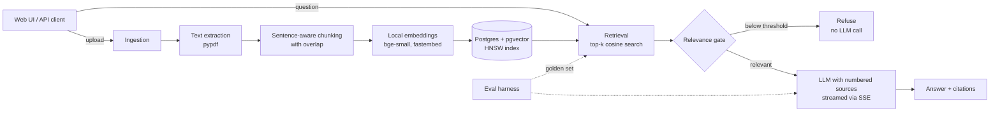

# DocPilot

**Ask questions about your documents and get answers that cite their sources, and refuse when the answer isn't there.**

DocPilot is a retrieval-augmented generation (RAG) service built with FastAPI, PostgreSQL + pgvector and any OpenAI-compatible LLM. It ships with an evaluation harness so retrieval and answer quality are measured, not guessed.


## Architecture



## Features

- **Ingestion:** PDF, TXT and Markdown; duplicate uploads detected by SHA-256.
- **Chunking:** sentence-aware packing with overlap; chunks never cross pages, so every citation points to one page.
- **Embeddings:** local `BAAI/bge-small-en-v1.5` via fastembed: free, CPU-only, no PyTorch.
- **Vector search:** pgvector with an HNSW index. A `tsvector` column and GIN index are already in place for hybrid search.
- **Grounded answers:** numbered sources in the prompt, mandatory `[n]` citations, exact refusal sentence when the answer isn't in the sources.
- **Relevance gate:** if the best chunk scores below `MIN_RELEVANCE`, DocPilot refuses without calling the LLM. This cuts cost and removes a whole class of hallucinations.
- **Prompt-injection guard:** retrieved text is labelled untrusted data in the system prompt.
- **Streaming:** Server-Sent Events (`sources` → `token`… → `done` / `error`).
- **Observability:** per-request timings for retrieval and generation.
- **Provider-agnostic:** Gemini, OpenAI, Groq or a local Ollama model, switched by configuration only.
- **Evaluation harness:** retrieval hit@k and MRR, answer accuracy, refusal accuracy, false-refusal rate, citation rate and latency p50/p95.
- **Tests and CI:** unit and API tests run without a database or API key; GitHub Actions runs ruff and pytest on every push.

## Quickstart

Requirements: Python 3.11+, Docker.

```bash
# 1. Start Postgres with pgvector
docker compose up -d

# 2. Install and configure
cd backend
python -m venv .venv && source .venv/bin/activate   # Windows: .venv\Scripts\activate
pip install -r requirements-dev.txt
cp .env.example .env        # then add LLM_API_KEY (a free Gemini key works)

# 3. Run
uvicorn app.main:app --reload
```

Open http://localhost:8000 for the UI, or http://localhost:8000/docs for the interactive API docs.
The first upload downloads the embedding model (~130 MB) once.

## API

| Method | Path | Purpose |
|---|---|---|
| `POST` | `/documents` | Upload and index a file (multipart `file`) |
| `GET` | `/documents` | List indexed documents |
| `DELETE` | `/documents/{id}` | Remove a document and its chunks |
| `POST` | `/search` | Retrieval only: `{"query", "top_k"}` |
| `POST` | `/ask` | Answer with sources and timings: `{"question", "top_k"}` |
| `POST` | `/ask/stream` | Same, streamed as Server-Sent Events |
| `GET` | `/health` | Database and LLM configuration status |

## Evaluation

`evals/golden.jsonl` holds 20 questions about a sample handbook (`evals/sample_docs/`): 16 answerable, each with the exact evidence sentence and expected facts, and 4 that the document cannot answer, to test refusal.

```bash
# with the API running, from the repository root
python evals/run_eval.py --upload evals/sample_docs/northwind_handbook.md --label baseline
```

Each run prints a per-question PASS/FAIL list and saves a JSON report to `evals/results/`.

### Results

| Run | hit@k | MRR | Answer acc. | Refusal acc. | False refusals | p95 latency |
|---|---|---|---|---|---|---|
| baseline (k=5) | _run it_ | | | | | |

### Experiments to run next

1. **Relevance threshold:** sweep `MIN_RELEVANCE` (0.45 → 0.70) and pick the value that keeps refusal accuracy high without raising false refusals.
2. **Chunk size:** compare `CHUNK_MAX_CHARS` 500 / 1000 / 1500 at `--top-k 3`.
3. **Harder corpus:** index several long PDFs so retrieval actually has to discriminate, and extend the golden set.

## Design decisions

- **pgvector over a dedicated vector database.** One datastore for documents, chunks, vectors and (soon) full-text search keeps transactions simple: a document and all its chunks are written atomically, and deletes cascade.
- **Local embeddings.** No per-token cost for indexing, no data leaves the machine at ingestion, and re-indexing is free while experimenting with chunking.
- **Refusal before generation.** A cheap similarity threshold decides whether to call the LLM at all, so unanswerable questions cost nothing and can't be hallucinated.
- **Filename as a contextual header.** Each chunk is embedded with its document name prepended, so short chunks keep their context.
- **Pages as hard chunk boundaries.** Slightly smaller chunks in exchange for citations that always point to a single page.

## Roadmap

- [ ] Next.js frontend
- [ ] Hybrid search (BM25 via `tsvector` + vector, reciprocal rank fusion) and a reranker
- [ ] LLM-as-judge faithfulness scoring in the eval harness
- [ ] Multi-tenancy: organizations, API keys, Postgres row-level security
- [ ] Async ingestion workers for large files
- [ ] Tracing with Langfuse / OpenTelemetry; semantic caching
- [ ] Deployment

## Project structure

```
backend/app/        FastAPI service: config, db, ingest, embeddings, retrieval, llm, main, static UI
backend/tests/      unit and API tests (no DB or API key needed)
evals/              golden set, sample document, eval harness and its tests
docker-compose.yml  Postgres 16 + pgvector
```

Note: the embedding dimension (384) is fixed in `schema.sql`. Changing `EMBEDDING_MODEL` to a model with a different dimension needs a matching schema change and a re-index.
